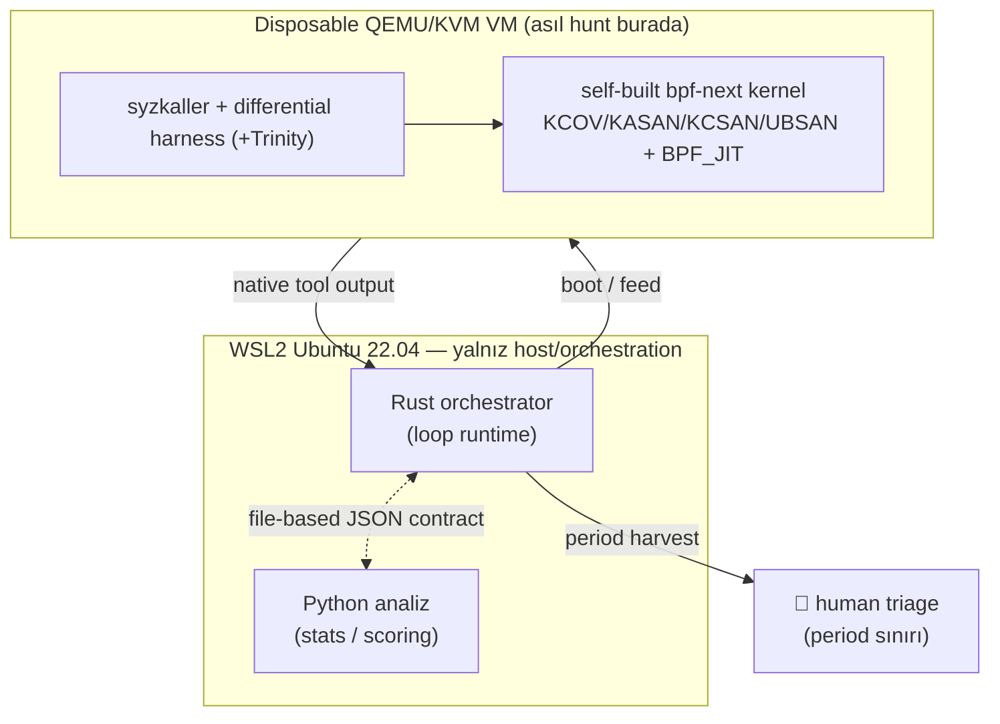

# eBPF Verifier Logic Bug Hunt — Mimari ve Mühendislik Prensipleri

> [!abstract] Bir cümlede
> `bpf-next` çekirdeğindeki [[eBPF Verifier|eBPF verifier]]'da **logic bug**,
> **temporal-logic bug** ve **corruption-to-primitive** araştırma izlerini avlayan,
> kendi kendine kapanan **operasyonel bir laboratuvar döngüsü** — *formal ispat
> sistemi değil*. "Ground truth" = dokümantasyon + patch diff'leri + klasik
> mantıksal analiz. İnsan, her periyot sınırında döngünün içinde.

> [!warning] Bu bir ispat sistemi DEĞİL
> Theorem prover yok, formal doğrulama yok, döngünün kendi sağlamlığını/tutarlılığını
> ispatlama çabası yok. Doğruluğun ölçüsü **gözlem ile dokümante/beklenen davranış
> arasındaki fark**tır — matematiksel bir modelin sağladığı garanti değil. Bu
> ayrım tüm mimarinin belkemiği; her tasarım kararı buna göre süzülür.

---

## 1. Araştırma hedefi

Linux çekirdeğinin **eBPF verifier**'ı, kullanıcı alanından gelen BPF programlarını
çekirdeğe yüklemeden önce statik olarak analiz eden bir soyut yorumlayıcıdır. Bir
program "güvenli" damgası aldığında kernel bağlamında çalışır — dolayısıyla
verifier'daki bir **mantık hatası doğrudan bir çekirdek güvenlik açığıdır**.

Avlanan üç sınıf:

| Sınıf | Ne demek | Neden verifier'da |
| --- | --- | --- |
| **Logic bug** | Verifier'ın soyut durumu (range/tnum) gerçek çalışma zamanı değerinden sapıyor → yanlış "accept" | Range tracking, [[tnum]] aritmetiği, helper kontratları |
| **Temporal-logic bug** | State-transition sırasına/geçmişine bağlı hata; tek instruction'da değil, yol/durum evriminde | State pruning, backtracking, path exploration |
| **Corruption-to-primitive** | Doğrulama boşluğunun okuma/yazma primitifine dönüştürülebilirliği (araştırma izi) | OOB, pointer arithmetic, spill/fill |

> [!info] Neden "logic" — memory-safety fuzzing değil
> Klasik kernel fuzzing çoğunlukla crash (KASAN/panic) peşindedir. Buradaki asıl
> hedef **sessiz mantık sapması**: verifier'ın *kabul ettiği ama yanlış olan*
> durumlar. Bunlar crash üretmez; ancak **gözlem ≠ dokümante davranış** diff'iyle
> yakalanır. Memory-safety sanitizer'ları (aşağıda) ikincil ağ olarak durur.

---

## 2. Ground truth — 4 kaynak (formal model değil)

Diff motoru, gözlenen çekirdek davranışını dört kaynağa karşı kıyaslar. Her birinin
`pipeline::groundtruth` altında bir loader/adapter'ı olacak:

1. **`verifier.c` state-transition mantığı** — accept/reject + register-state evrimi.
2. **`Documentation/bpf/verifier.rst`** — dokümante edilmiş davranış.
3. **Helper `bpf_func_proto` / `arg_type` kontratları** — her helper'ın argüman tip sözleşmesi.
4. **Sürümler arası patch diff'leri** — `git log` (kernel sürümleri arası); bir davranışın
   ne zaman/neden değiştiğinin tarihsel kanıtı.

> [!tip] "Documented-vs-observed" döngünün kalbi
> Anomaly scoring ilginç kayıtları *sıralar*; ama asıl iddia (**"bu davranış
> dokümante olandan sapıyor"**) bu dört kaynağa karşı yapılan diff'ten çıkar. `diff`
> stage'i **kuruldu**: dış-kaynak loader'ları (verifier.c/rst/patch) kernel tree
> gerektirdiği için TODO, ama **intrinsik mantıksal invariant'lar** (tnum
> iyi-biçimlilik, bound sıralaması, tnum↔bounds tutarlılığı, JIT↔interp eşdeğerliği —
> "klasik mantıksal analiz" sütunu) dış dosya olmadan şimdiden gerçek bulgu üretir.
> `diff` **saptar**, score **sıralar** (bulgularda severity yok; guardrail).

---

## 3. Yürütme mimarisi (nerede koşuyor)



- **Host / orchestration:** WSL2 Ubuntu 22.04 on Windows 11 (KVM açık, nested virt
  açık). Bu katman **sadece** orkestrasyon — asıl hunt burada dönmez.
- **Yürütme:** [[QEMU-KVM]] **disposable VM**'ler, **self-built `bpf-next` kernel**'leri
  koşar. VM tek kullanımlık; bu yüzden veri host'a *harvest* edilir (bkz. §7,
  "kopyala, referans verme").
- **TCG fallback:** KVM'siz saf-yazılım yol (yavaş) — yalnız **manuel PoC /
  differential** için, asıl throughput için değil. `/dev/kvm` yoksa devreye girer.

---

## 4. Fuzzing stack & kernel config

- **Birincil:** [[syzkaller]] (Go gerekir) — coverage-guided kernel fuzzer.
- **Differential harness:** verifier-accepts programını **interpreter vs [[BPF JIT|JIT]]**
  retval + `data_out` farkı için koşar (JIT↔interp sapması = güçlü hard-signal).
- **Opsiyonel:** Trinity (syscall fuzzer).
- **Kernel `.config`** şunları açar: [[KCOV]] (coverage feedback), [[KASAN]]
  (memory-safety), KCSAN (data-race), UBSAN (undefined behavior), `BPF_JIT`,
  `BPF_JIT_ALWAYS_ON`, `DEBUG_INFO_BTF` (+ BTF/pahole ön-koşulları).
  → `config/kernel/bpf-verifier-lab.config`.

> [!note] Hangi araç hangi CORE alanını üretir (veri-kaynağı haritası)
> Bu ayrım kritik: **syzkaller tek başına verifier'ın accept/reject + register-state
> çıktısını ÜRETMEZ** — o veri kernel'in verifier **log buffer**'ında
> (`BPF_PROG_LOAD .log_level=2`) ve dmesg'de yaşar. Doğrulandı: 200 sn'lik bir
> kampanyanın default çıktısı yalnız `manager log + corpus.db (+ crashes/)`.
>
> | CORE alanı | Gerçek kaynak | Üreten |
> | --- | --- | --- |
> | verifier decision + reason | `BPF_PROG_LOAD` retval + log_buf | **differential harness** (dmesg fallback) |
> | register-state evrimi (tnum/bounds/reg type) | verifier log buffer @ `log_level=2` | **differential harness** |
> | `insn_processed` / processed states | verifier log/stats | **differential harness** |
> | JIT↔interp retval + `data_out` | `BPF_PROG_TEST_RUN`, **iki kernel** (JIT vs interpreter) | differential harness — **ertelendi**, bkz ⚠️ |
> | coverage delta (yeni BB) + exec N | KCOV | **syzkaller** |
> | helper `arg_type` ihlali | call-site reg tipleri (log buffer) ⋈ proto | **diff** stage (kaynak: harness log) |
>
> Sonuç: syzkaller'ın işi **coverage-güdümlü input üretimi + crash yüzeye çıkarma**;
> verifier-semantik CORE alanlarının birincil üreticisi **differential harness**'tir.
> Bu yüzden §5'teki "gerçek per-tool parser" tek değil **iki** parser'a bölünür:
> (a) syzkaller coverage/crash parser'ı, (b) differential-harness verifier-log parser'ı
> — verifier mantık hataları asıl (b)'de yüzeye çıkar.
>
> ⚠️ **JIT↔interp differential tek kernel'de YAPILAMAZ.** Primary kernel
> `CONFIG_BPF_JIT_ALWAYS_ON=y` ile derli → interpreter derleme-dışı, `bpf_jit_enable`
> 1'e sabit. Bu sinyal **ayrı bir interpreter-only kernel** (`ALWAYS_ON` kapalı,
> `bpf_jit_enable=0`) + cross-kernel koşu ister; sonraki bir harness moduna ertelendi.
> Harness v0 **decision + register-state** üretir (bkz `harness/`, devlog 0011).

---

## 5. Döngü (pipeline)

```
fuzzer/recon output
  → ingest      (ham çıktıyı DEĞİŞTİRMEDEN topla)
  → normalize   (4 metrik grubu şemasına yorumla)
  → score       (Python, anomaly scoring — insan triyajı için SIRALAR)
  → diff        (documented-vs-observed; intrinsik invariant + oracle)  ✅ (dış loader TODO)
  → report      (score ⋈ diff; triyajlı PERIOD_REPORT batch'i)          ✅
  → 👤 human-in-the-loop → bir sonraki periyoda geri besler
```

Her stage `pipeline` crate'inde ayrı bir modül; typed input/output. Şu anki durum:

| Stage | Durum | Not |
| --- | --- | --- |
| `ingest` | ✅ | byte-for-byte topla, `RAW_INDEX` yaz |
| `normalize` | ✅ | frozen şemaya yorumla; **golden fixture + `ReferenceParser`** anchor'ı var (parser-katmanı guardrail); gerçek per-tool parser'lar (syz + harness) TODO |
| `score` | ✅ | Rust→Python subprocess; `baseline-hard-signals-v0`; istatistik TODO |
| `diff` | ✅ | intrinsik mantıksal invariant + enjekte `GroundTruth` oracle; dış-kaynak loader TODO |
| `report` | ✅ | `ANOMALY_SCORES` ⋈ `DIFF_FINDINGS` → triyajlı `PERIOD_REPORT`; score'a göre sıralı, yeni severity yok |

> [!success] Pipeline uçtan uca çalışıyor
> Beş stage de (`ingest → normalize → score → diff → report`) tam olarak koşuyor —
> mock fuzzer'dan başlayıp insana teslim edilen triyajlı batch'e kadar. Kalan iş
> **kod değil, entegrasyon**: gerçek native-format parser'lar, gerçek `FuzzDriver`/VM
> ([[QEMU-KVM]] + [[syzkaller]]), ve dış ground-truth loader'ları (verifier.c/rst/patch,
> [[bpf-next]] tree gelince).

---

## 6. Period modeli — **N = exec count, zaman DEĞİL**

> [!important] Periyot = toplam fuzzing exec sayısı (bir sayaç)
> Bir **periyot**, döngünün büyüyüp insana **triyajlı bir veri batch'i** teslim
> ettiği aralıktır. Sınır **kümülatif exec sayısı** N, 2N, 3N…'dir — **sabit süre
> değil.** Duvar-saati zaman yalnızca veriye basılan bir **timestamp/label**'dır;
> **asla durma kriteri değildir.** İkincil bir **verimlilik gözlemi** (exec başına
> yeni coverage / yeni state) *yalnız rapor için* tutulur — karar kriteri değil.

Bunun nedeni: zaman-tabanlı periyotlar donanım hızına/gürültüye bağımlıdır ve
karşılaştırılamaz; exec-tabanlı periyotlar **deterministik ve makine-bağımsız iş
birimi** verir.

---

## 7. Dört metrik grubu

`metrics` crate'inde ayrı şema modülleri (+ `python/.../schemas/` aynası). Şema
**donduruldu** (serde). CORE "full + register-state evolution" varyantı.

1. **CORE** — sabit, saf operasyonel gözlem, ground-truth'a bağlı, **her zaman açık**,
   **counterfactual katmanından bağımsız**, tek başına anlamlı. İçerir:
   - Verifier kararı (accept / reject + reason).
   - **Register-state evrimi**: insn başına snapshot; her reg için [[tnum]] `value`/`mask`,
     `umin`/`umax`/`smin`/`smax`, reg type.
   - `insn_processed` / processed states.
   - **JIT↔interpreter** retval + `data_out` farkı.
   - Coverage delta (KCOV, exec başına yeni BB) + exec sayacı N.
   - Helper `arg_type` kontrat-ihlali sinyali.
2. **DERIVED** — şema sabit; değerler döngü büyüdükçe dolar (ör. `efficiency_per_exec`
   — **REPORT-ONLY**).
3. **COUNTERFACTUAL** — ekstra / **opt-in**; core'un **ÜSTÜNDE** oturur, onu asla
   değiştirmez. Kasıtlı olarak core'un **dışında** tutulur ki motor ham gözlemi
   okusun, döngünün kendi ürettiği alternatifleri değil.
4. **"Did the loop expect this?" flag** — confirmation bias'ı **ölçmek** için ayrı
   alan (NoPrediction / Expected / Unexpected).

> [!note] Neden verbatim `String` (enum değil)
> `reg_type` ve reject `reason` ham `String` olarak saklanır. Kernel sürümleri arası
> bu etiketler kayar (drift); enum'a hapsetmek ham gözlemi bozar. **Ham veriyi
> kutsal tut** ilkesinin şema-seviyesindeki yansıması.

---

## 8. Confirmation-bias guardrail (HARD) — mimarinin ahlakı

> [!danger] Çözülmüş bir problem değil, canlı bir stres noktası
> Döngünün counterfactual çıktı üretme yükümlülüğü, onu kendi beklentisini
> **doğrulamak için input üreten** bir *counterfactual-optimizing* sürece —
> yani **confirmation-biased bir fuzzer**'a — dönüştürmemeli. Scoring /
> counterfactual / input-selection yolundaki **her değişiklik** buna karşı
> denetlenmeli. (Tam metin `crates/orchestrator/src/loop_runtime.rs` içinde
> yorum olarak gömülü — orada kalmalı.)

Üç koruma:

1. **CORE, counterfactual katmanından bağımsız** — motor ham gözlemi okur, döngünün
   ürettiği alternatifleri değil.
2. **"expected?" flag** — bias **gizlenmez, ölçülür**.
3. **Her periyot sınırında human-in-the-loop** — nihai süzgeç insandır.

Somut invariant: **skorlar insan triyajı için SIRALAR; fuzzer input seçimini ASLA
beslemez** (`scoring.py` + `score.rs` içinde yazılı). Skor, geri-besleme kapısını
otomatik açan bir sinyal olsaydı, döngü kendi beklediğini avlamaya başlardı.

---

## 9. Dil sınırı — Rust ⟷ Python (file-based JSON contract)

İki dil, **temiz ve dokümante bir sınırda** buluşur:

- **Rust** — mimari, orkestrasyon, servisler, loop runtime, VM kontrolü.
- **Python** — istatistik, veri işleme, metrik analizi, anomaly scoring.

Buluşma noktası **typed, file-based JSON artifact contract**'tır: Rust orchestrator
normalized-metric artifact'larını bir periyot dizinine yazar, Python analyzer'ı
çağırır, skorları geri okur — **paylaşılan process belleği yok**. Contract `contract`
crate'inde tanımlı, `python/.../contract.py`'de aynalanır; ikisi **lockstep**.

> [!example] Neden dosya, neden process-belleği değil
> "Periodic harvest" modeliyle birebir örtüşür: disposable VM → host'a dosya,
> host → Python'a dosya. Artifact'lar denetlenebilir, tekrar-oynatılabilir,
> dil-bağımsız ve periyot dizininde kalıcı kanıt bırakır. Envelope: `Artifact<T>`
> = `{ contract_version, period_id, producer, payload }`, atomik yazılır, okurken
> versiyon-kontrollü.

---

## 10. Mühendislik prensipleri (taşınabilir dersler)

Bu döngüye özgü olmayan, başka araştırma-altyapılarına da taşınabilir kararlar:

- [ ] **Ham çıktıyı değiştirmeden topla; normalization ayrı, sonraki bir stage.**
  Asla kaynakta yorumlama. (`ingest` byte-for-byte kopyalar; `normalize` yorumlar.)
  Erken yorum = geri-döndürülemez bilgi kaybı + confirmation bias sızıntısı.
- [ ] **Frozen contract ≠ replaceable logic — ayrımı bilinçli yönet.** Dondurulan
  bir sözleşmeyse (envelope, CORE şema) **kullanıcıya sor**; değiştirilebilir bir
  logic ise (scoring yöntemi) makul bir baseline ile ilerle, `TODO` bırak.
- [ ] **Enjekte edilebilir soyutlama + mock/reference implementasyon.** `FuzzDriver`/
  `MockDriver`, `RecordParser`/`UnimplementedParser`, `Analyzer`/`PythonAnalyzer`.
  Böylece kontrol akışı **gerçek fuzzer/VM/Python olmadan** test edilir; gerçek
  implementasyon "swap-in".
- [ ] **Kanıt > iddia.** Her stage için gerçek e2e ispat (cross-language round-trip,
  `diff = IDENTICAL`, gerçek subprocess) — "çalışıyor" demek yetmez, gösterilir.
- [ ] **Atomik dosya yazımı** (tmp sibling + `rename`/`os.replace`) — okuyucu asla
  yarım dosya görmez.
- [ ] **Deterministik & offline.** Bağımlılıklar cache'ten offline derlenir;
  fingerprint (FNV-1a-64) ve mtime-int gibi seçimler **date/crypto bağımlılığı
  eklemeden** deterministik kalır.
- [ ] **Ölçü doğal iş birimi olsun** (exec count), duvar-saati değil — makine-bağımsız,
  karşılaştırılabilir.
- [ ] **Human-in-the-loop sınırları açık olsun.** Otomasyon triyaj *sıralar*; kararı
  insan verir. Kritik/geri-döndürülemez kapı hiçbir zaman skor tarafından açılmaz.
- [ ] **Belirtilmemiş her tasarım kararını sor, yoksa `TODO` olarak bırak** — ad hoc
  karar verme. (Standing instruction; bkz. §8 guardrail felsefesiyle uyumlu.)
- [ ] **Devlog disiplini** — ne/neden/hangi karar, iddia değil kanıt ile. Bkz.
  `docs/devlog/devlog.md`.

---

## 11. İlgili notlar & referanslar

- Proje devlog'u: `docs/devlog/devlog.md` (0001–0005).
- Kaynaklar: `verifier.c`, `Documentation/bpf/verifier.rst`, `bpf_func_proto`/`arg_type`,
  [[bpf-next]] git history.
- Kavramlar: [[eBPF Verifier]] · [[tnum]] · [[syzkaller]] · [[KCOV]] · [[KASAN]] ·
  [[QEMU-KVM]] · [[BPF JIT]] · [[Confirmation Bias]]

> [!quote] Tek satırlık pusula
> **Gözlem ≠ dokümante davranış** — döngünün tüm amacı bu farkı, önyargısız
> toplayıp insana sıralı biçimde sunmaktır.
